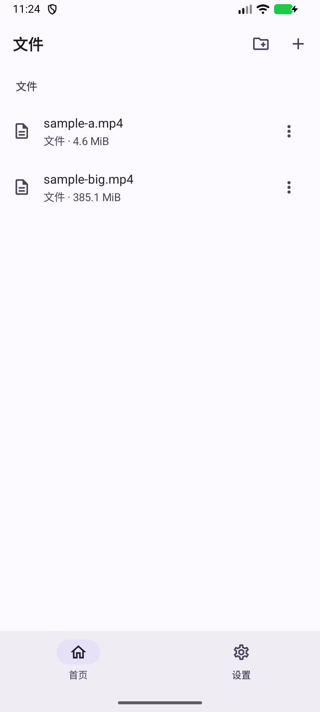
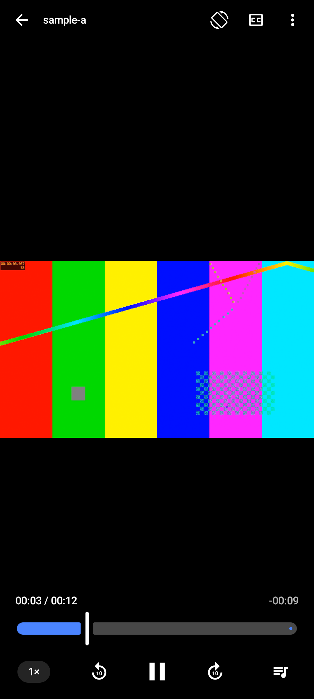
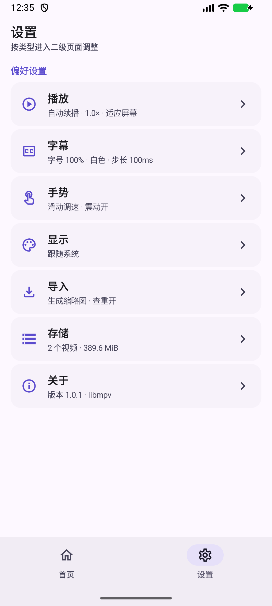
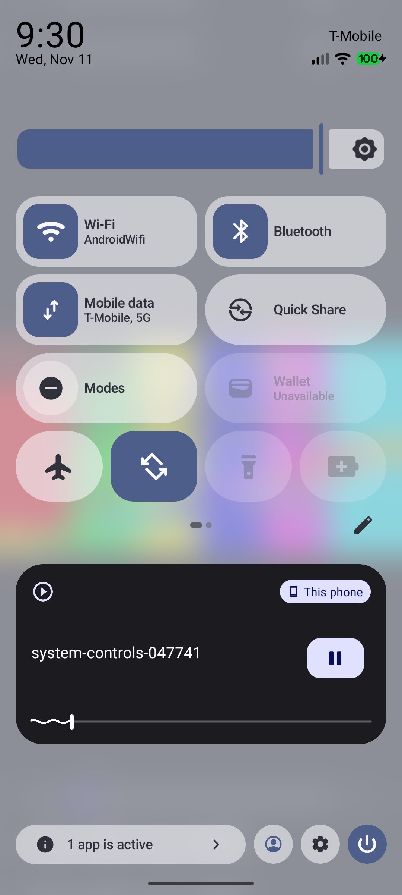

<p align="center">
  
</p>

<h1 align="center">ZeroPlayer</h1>

<p align="center">Android 私有影音管理与专业播放器：文件全部留在应用私有存储，播放由 libmpv 完成。</p>

<p align="center">
  <a href="https://github.com/zerobiubiu/ZeroPlayer/releases/latest"></a>
  <a href="https://github.com/zerobiubiu/ZeroPlayer/actions/workflows/ci.yml"></a>
  <a href="LICENSE"></a>
  
</p>

## 简介

ZeroPlayer 是一款单机 Android 播放器：不扫描系统媒体库、不申请媒体权限、不做网络媒体库。用户通过系统文件选择器或局域网网页把文件复制进应用私有目录，首页以文件树管理这些文件，点击即用 libmpv 播放。

- 显示名称 ZeroPlayer；应用 ID 保持 `com.privateplayer.media`，不因更名迁移私有数据。
- 容量按 1024 进制计算并显示为 `KiB`、`MiB`、`GiB`、`TiB`。
- 只打包 `arm64-v8a` 原生库，只支持 ARM64 设备。

## 功能

| 模块 | 能力 |
|---|---|
| 首页 | 统一私有文件树（目录/文件）、本机导入、Wi-Fi 导入、长按管理 |
| 导入 | SAF 单选/多选、系统分享、局域网网页上传；流式复制、断点续传、重复检测、空间检查、取消与重试 |
| 播放 | libmpv 解码渲染；手势调亮度/音量/进度、双击跳转、长按倍速、字幕与音轨切换、画面比例、记住进度、自动下一集 |
| 系统集成 | Media3 媒体会话、通知栏与锁屏控制、后台播放、文件管理器“打开方式”、系统分享 |
| 管理 | 重命名、移动、删除、详情、导出到系统目录、系统分享 |
| 设置 | 深浅色与跟随系统、播放/字幕/手势/显示/导入/存储设置 |

播放器界面全部由 Compose 实现，不显示 MPV 自带控件；进度拖动在小步进时有虚拟预览条与触觉反馈，字幕默认贴在视频画面下侧的留黑区。

## 截图

| 文件树 | 播放器 | 设置 | 系统媒体控制 |
|---|---|---|---|
|  |  |  |  |

## 安装

从 [Releases](https://github.com/zerobiubiu/ZeroPlayer/releases/latest) 下载 `ZeroPlayer-<版本>-arm64-v8a.apk`，与同名 `.sha256` 校验值一并提供。

```bash
sha256sum -c ZeroPlayer-1.0.0-arm64-v8a.apk.sha256
adb install -r ZeroPlayer-1.0.0-arm64-v8a.apk
```

- 需要 Android 8.0（API 26）以上、ARM64 设备；不支持 32 位 ARM 或无 ARM64 转译的 x86 模拟器。
- 安装包签名由项目固定的发行密钥产生，后续版本可直接覆盖升级；请只从本仓库 Releases 下载。
- 播放器内已静态链接 libmpv、FFmpeg 等库，安装后无需额外下载解码器。

## 构建

需要 JDK 17+、Android SDK Platform 37 与 Build-Tools 36.0.0（`local.properties` 指向本机 SDK）。

```bash
./gradlew :app:assembleDebug          # 调试包
./gradlew testDebugUnitTest lintDebug # 单元测试与静态检查
./gradlew :app:assembleRelease        # 发行包（无签名材料时使用调试签名）
```

本地构建发行包时，在仓库根目录放置 `keystore.properties`（已在 `.gitignore` 中排除）：

```properties
storeFile=/absolute/path/release.jks
storePassword=******
keyAlias=zeroplayer
keyPassword=******
```

也可以改用环境变量 `ZEROPLAYER_STORE_FILE`、`ZEROPLAYER_STORE_PASSWORD`、`ZEROPLAYER_KEY_ALIAS`、`ZEROPLAYER_KEY_PASSWORD`。

工具链：Gradle 9.6.0、AGP 9.5.1（内置 Kotlin 2.2.10）、KSP 2.3.13、compileSdk/targetSdk 37、minSdk 26。

**设备测试警告：**`connected*AndroidTest` 在本机实测会在结束后卸载被测应用、清空私有媒体。工程默认拦截该任务，只有确认使用可丢弃模拟器时才加 `-PallowDestructiveConnectedTests=true`。

原生播放库已随仓库提供；若需从源码重建，见 `tools/mpv-static/build.sh`，需要 Linux/WSL2、Android NDK r29 及脚本列出的依赖。源码版本与 SHA-256 固定在 `tools/mpv-static/sources.tsv`。

## 发布流程

1. 更新 `docs/CHANGELOG.md`，确认 `.gitignore` 未收录签名材料；
2. 打标签并推送：`git tag v1.0.1 && git push origin v1.0.1`；
3. `.github/workflows/release.yml` 自动安装 SDK、按标签推导 `versionName`/`versionCode`、用发行密钥签名、校验产物并创建 GitHub Release。

`versionCode = major × 10000 + minor × 100 + patch`，因此版本号必须严格递增。推送 `main` 或发起拉取请求会触发 `ci.yml` 的测试、Lint 与调试包构建。完整说明见 [发布流水线](docs/architecture/release-pipeline.md)。

## 工程结构

```text
app/                  唯一 Activity、系统 Intent、NavHost、MediaSessionService
core/common/          调度器、格式化、文件名规则、应用级协程作用域
core/design/          Material 3 主题、间距、组件、媒体卡片
core/database/        Room 实体/DAO/数据库
core/datastore/       偏好设置仓库
core/storage/         私有存储、流式复制、元数据探测、缩略图、SAF
core/playback/        播放引擎、libmpv、Surface、SimpleBasePlayer 系统适配
domain/               模型、仓库接口、用例
data/                 文件树与数据仓库、ImportWorker、局域网文件服务
feature/home|detail|importer|player|settings
tools/mpv-static/     libmpv 构建脚本、JNI 与来源清单
docs/                 架构、决策、排查、变更记录
```

依赖规则：`feature → core/domain`，`data → core*/domain`；UI 不直接接触数据库、文件系统或 MPV。

## 存储布局

```text
files/media/          首页和网页共享的私有文件树
files/subtitles/<id>/ 旧版或详情页单独导入的字幕副本
files/import-staging/ 本机选择或分享文件的持久导入暂存
files/web-uploads/    网页上传暂存与接收恢复记录
files/import-commits/ 提交身份日志（dev/ino、长度与目标路径）
cache/thumbnails/     缩略图（可清理）
databases/media.db    Room
```

原始文件只在用户选择后读取，复制完成前不改动、不移动、不删除。

## Wi-Fi 文件服务

1. 手机连接局域网，在首页右上角点击「+」选择「通过 Wi-Fi 导入」并启动服务；Android 17 及以上需要授予局域网权限。
2. 在同网络设备的浏览器打开应用显示的 `http://手机IP:8765/`，可浏览、上传任意文件（含字幕）、下载、建目录、重命名、移动与删除。
3. 服务使用固定端口与根路径，**没有登录或令牌**：能访问该地址的设备都可读写删除文件，请只在可信网络中临时开启，用完后在浮层或通知栏停止。

## 已知限制

- 已在 Android 17 x86_64 模拟器的 ARM64 转译环境完成播放回归；实体 ARM 设备、低版本系统与物理硬件解码仍需验证，模拟器结果不等于真机硬解。
- 手势、编码、字幕类型与设备组合仍按测试矩阵逐步补充。
- 文件树按目录直接列出，超大目录尚未分页。
- 局域网服务为明文 HTTP，无身份校验。

## 许可证

本项目以 [GNU General Public License v3.0 only](LICENSE) 发布。

安装包内含静态链接的 libmpv、FFmpeg、libplacebo、libass 等第三方组件（LGPL 等多种许可证），分发时需按各许可证提供源码与重新链接材料：见 [THIRD_PARTY_NOTICES.md](THIRD_PARTY_NOTICES.md) 与 `tools/mpv-static/NOTICE.txt`。
