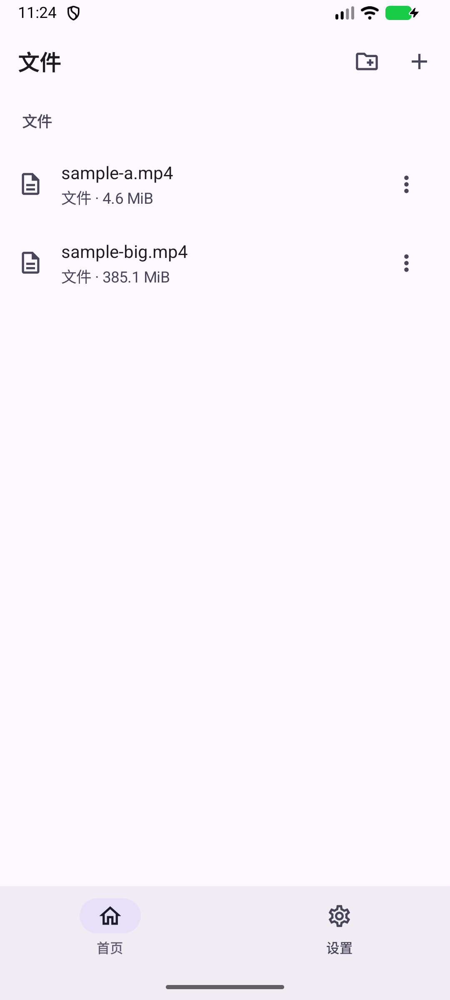
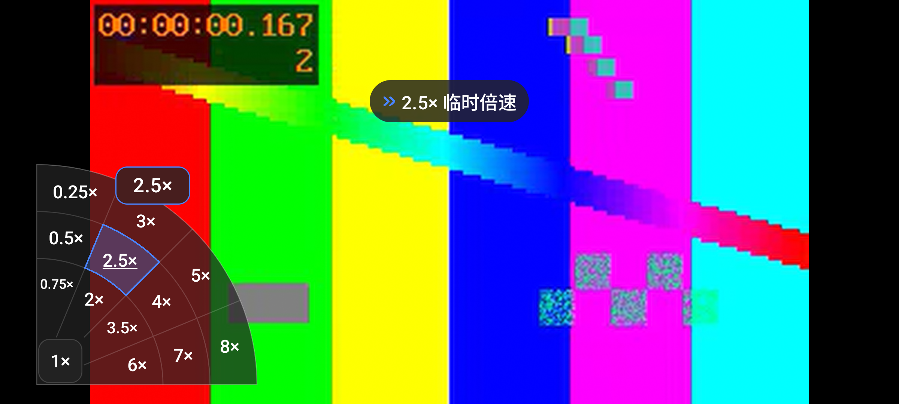
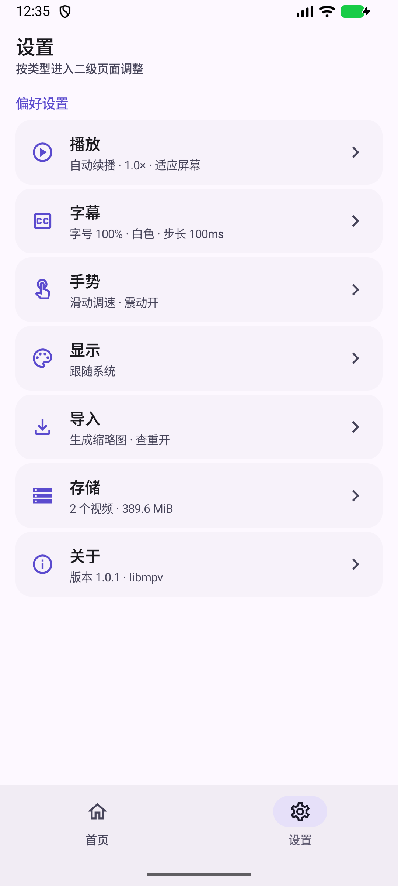
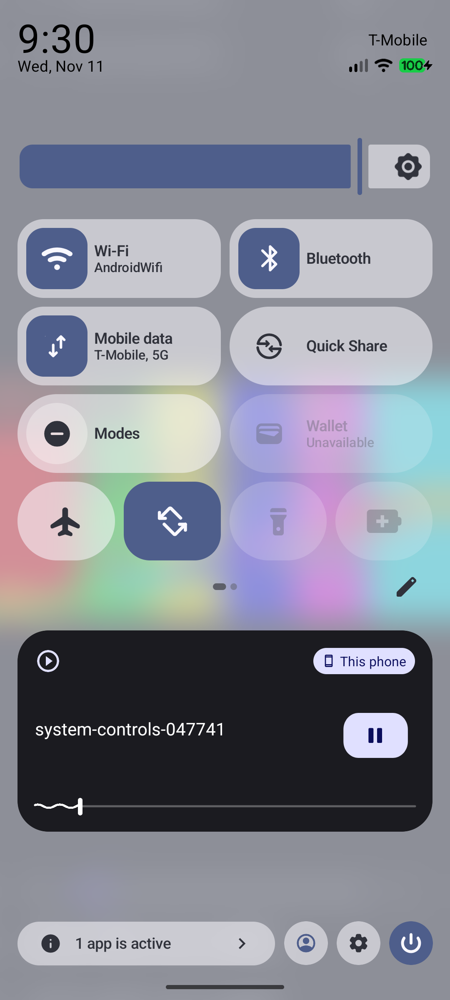

<p align="center">
  
</p>

<h1 align="center">ZeroPlayer</h1>

<p align="center">Android 私有影音管理与专业播放器：文件全部留在应用私有存储，播放由 libmpv 完成。</p>

<p align="center">
  <a href="https://github.com/zerobiubiu/ZeroPlayer/releases/latest"></a>
  <a href="https://github.com/zerobiubiu/ZeroPlayer/actions/workflows/ci.yml"></a>
  <a href="LICENSE"></a>
  
</p>

## 简介

ZeroPlayer 是一款单机 Android 播放器：不扫描系统媒体库、不申请媒体权限、不做网络媒体库。用户通过系统文件选择器或局域网网页把文件复制进应用私有目录，首页以文件树管理这些文件，点击即用 libmpv 播放。

- 显示名称 ZeroPlayer；应用 ID 保持 `com.privateplayer.media`，不因更名迁移私有数据。
- 容量按 1024 进制计算并显示为 `KiB`、`MiB`、`GiB`、`TiB`。
- 只打包 `arm64-v8a` 原生库，只支持 ARM64 设备。

## 功能

| 模块 | 能力 |
|---|---|
| 首页 | 私有文件树、本机及 Wi-Fi 导入；长按选择，单项重命名/更多，批量移动/删除 |
| 导入 | SAF、系统分享及网页上传；流式续传、空间与重复检查。本机普通取消保留暂存，失败或已取消的本机任务可确认放弃并清理 |
| 播放 | libmpv 解码渲染；三区双击、滑动调节、0.25–8× 倍速、音轨与字幕、画面比例、断点策略和自动下一文件 |
| 系统集成 | Media3 媒体会话、通知栏与锁屏控制、后台播放、文件管理器“打开方式”、系统分享 |
| 管理 | 重命名、移动、删除、详情、导出到系统目录、系统分享 |
| 设置 | 观看、文件、应用三组共七页；字幕外观全局保存，字幕延时按视频记忆 |

双击画面左、右两侧可快退或快进，双击中央可播放或暂停；拖动可预览进度。播放器控件由 Compose 绘制，字幕由 libmpv 渲染，字幕外观、延时与 ASS 作者排版见[播放与字幕](docs/changes/0026-player-subtitles-and-navigation.md)。

左下角的[单手倍速扇面](docs/changes/0038-compact-speed-fan.md)支持轻点选档，也可按住滑选。原地松手不改速；主动滑到任一档会立即试播，松手选定，滑回 **1×** 方块也一样。滑出扇区才撤销试播、恢复原速。紧凑的半透明扇区会随滑动方向调整换档边界，指尖旁的键帽显示候选档，画面上半部显示实际试播倍速。长按视频画面仍只临时加速。

## 截图

| 文件树 | 单手倍速（横屏） | 设置 | 系统媒体控制 |
|---|---|---|---|
|  |  |  |  |

播放器图来自 1.4.0 的设备验证；其余图片为既有版本示例。各版变化见[更新记录](docs/CHANGELOG.md)。

## 安装

打开本仓库的 [GitHub 正式发行页](https://github.com/zerobiubiu/ZeroPlayer/releases/latest)，在 **Assets** 中下载 `ZeroPlayer-<版本>-arm64-v8a.apk`，在手机上点开安装。

如需校验，同时下载 `ZeroPlayer-<版本>-arm64-v8a.apk.sha256`，将两份文件放在同一目录，在电脑上运行 `sha256sum -c 校验文件名`（使用下载的完整文件名）。显示 `OK` 表示 APK 与发行页提供的摘要一致。

- 需要 Android 8.0（API 26）以上、ARM64 设备；不支持 32 位 ARM 或无 ARM64 转译的 x86 模拟器。
- 正式 APK 使用项目固定的[发行签名](docs/architecture/release-pipeline.md#产物与校验)，可覆盖升级；本地调试包不是正式发行包。
- 播放器内已静态链接 libmpv、FFmpeg 等库，安装后无需额外下载解码器。

## 构建

需要 JDK 17+、Android SDK Platform 37 与 Build-Tools 36.0.0（`local.properties` 指向本机 SDK）。

```bash
./gradlew :app:assembleDebug          # 调试包
./gradlew testDebugUnitTest lintDebug # 单元测试与静态检查
./gradlew :app:assembleRelease        # 发行包（无签名材料时使用调试签名）
```

本地构建发行包时，在仓库根目录放置 `keystore.properties`（已在 `.gitignore` 中排除）：

```properties
storeFile=/absolute/path/release.jks
storePassword=******
keyAlias=zeroplayer
keyPassword=******
```

也可以改用环境变量 `ZEROPLAYER_STORE_FILE`、`ZEROPLAYER_STORE_PASSWORD`、`ZEROPLAYER_KEY_ALIAS`、`ZEROPLAYER_KEY_PASSWORD`。

工具链：Gradle 9.6.0、AGP 9.5.1（内置 Kotlin 2.2.10）、KSP 2.3.13、compileSdk/targetSdk 37、minSdk 26。

**设备测试警告：**`connected*AndroidTest` 在本机实测会在结束后卸载被测应用、清空私有媒体。工程默认拦截该任务，只有确认使用可丢弃模拟器时才加 `-PallowDestructiveConnectedTests=true`。

原生播放库已随仓库提供；若需从源码重建，见 `tools/mpv-static/build.sh`，需要 Linux/WSL2、Android NDK r29 及脚本列出的依赖。源码版本与 SHA-256 固定在 `tools/mpv-static/sources.tsv`。

## 发布流程

1. 核对 [`app/build.gradle.kts`](app/build.gradle.kts) 的版本与[更新记录](docs/CHANGELOG.md)，确认签名材料未被 Git 跟踪；
2. 推送 `main` 并等 CI 通过，再对同一提交打对应的 `vX.Y.Z` 标签，只推送该标签；
3. [Release 工作流](.github/workflows/release.yml)按标签推导版本，签名后核对固定证书、应用 ID、版本、唯一 ARM64 架构及非调试属性；签名配置不全或校验失败时不发布。

`versionCode = major × 10000 + minor × 100 + patch`，因此版本号必须严格递增。推送 `main` 或发起拉取请求会触发 `ci.yml` 的测试、Lint 与调试包构建。完整说明见 [发布流水线](docs/architecture/release-pipeline.md)。

## 工程结构

```text
app/                  唯一 Activity、系统 Intent、NavHost、MediaSessionService
core/common/          调度器、格式化、文件名规则、应用级协程作用域
core/design/          Material 3 主题、间距、组件、媒体卡片
core/database/        Room 实体/DAO/数据库
core/datastore/       偏好设置仓库
core/storage/         私有存储、流式复制、元数据探测、缩略图、SAF
core/playback/        播放引擎、libmpv、Surface、SimpleBasePlayer 系统适配
domain/               模型、仓库接口、用例
data/                 文件树与数据仓库、ImportWorker、局域网文件服务
feature/home|detail|importer|player|settings
tools/mpv-static/     libmpv 构建脚本、JNI 与来源清单
docs/                 架构、决策、排查、变更记录
```

依赖规则：`feature → core/domain`，`data → core*/domain`；UI 不直接接触数据库、文件系统或 MPV。

## 存储布局

```text
files/media/          首页和网页共享的私有文件树
files/subtitles/<id>/ 旧版或详情页单独导入的字幕副本
files/import-staging/ 本机选择或分享文件的持久导入暂存
files/web-uploads/    网页上传暂存与接收恢复记录
files/import-commits/ 提交身份日志（dev/ino、长度与目标路径）
cache/thumbnails/     缩略图（可清理）
databases/media.db    Room
```

外部来源始终只读，取消、放弃导入及删除应用中的副本都不修改原文件。手机和网页删除均会复核此前选中的对象；同目录字幕和详情页单独导入的私有副本取舍不同，见[私有文件树与导入](docs/architecture/storage-and-import.md)。

## Wi-Fi 文件服务

1. 在首页目标目录点「+」→「通过 Wi-Fi 导入」→「启动服务」。Android 17 及以上需允许局域网访问。
2. 在同一局域网的设备上，打开手机列出的对应地址（`http://手机IP:8765/`）。网页可切换目录、选择或拖放多个文件上传；队列显示「已保存」才表示文件已进入手机目录。也支持下载、新建文件夹、重命名、移动和删除。
3. 同时连接 Wi-Fi、以太网或可识别的热点时，面板只列出实际启动成功的地址。服务使用明文 HTTP，**没有登录或令牌**，能连接的设备可读写和删除文件。仅在可信网络使用，用完后在面板或通知栏停止。

[导入失败时](docs/changes/0037-import-failure-recovery.md)，如果网页上传的暂存文件已丢失，请在网页重新选择原文件并上传；旧任务不能重试，也没有暂存可下载。如果只是目标文件夹不可用，按原路径恢复文件夹后，重试原任务即可。

## 已知限制

- 已在 Android 17 x86_64 模拟器的 ARM64 转译环境完成播放回归；实体 ARM 设备、低版本系统与物理硬件解码仍需验证，模拟器结果不等于真机硬解。
- 手势、编码、字幕类型与设备组合仍按测试矩阵逐步补充。
- 文件树按目录直接列出，超大目录尚未分页。
- 局域网服务为明文 HTTP，无身份校验。

## 许可证

本项目以 [GNU General Public License v3.0 only](LICENSE) 发布。

安装包内含静态链接的 libmpv、FFmpeg、libplacebo、libass 等第三方组件（LGPL 等多种许可证），分发时需按各许可证提供源码与重新链接材料：见 [THIRD_PARTY_NOTICES.md](THIRD_PARTY_NOTICES.md) 与 `tools/mpv-static/NOTICE.txt`。
