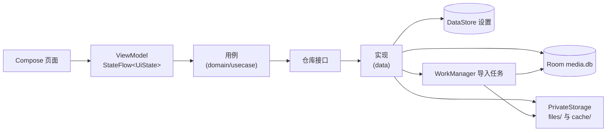

# 工程架构

状态：现状文档（随实现演进更新）
影响范围：全部模块

## 1. 模块划分与依赖方向

```text
app                     ← 唯一 Application / Activity / NavHost / 底部导航
feature:{home,detail,importer,player,settings}
        ↓ 只依赖 core:design、core:common、domain（player 另依赖 core:playback）
data                    ← Repository 实现、导入 Worker、Mapper、Hilt 绑定
        ↓
core:{common,design,database,datastore,storage,playback}
domain                  ← 领域模型、仓库接口、用例（不依赖 Android UI/Compose）
```

依赖规则（代码评审时按此检查）：

| 约束 | 落实情况 |
|---|---|
| UI 不直接操作数据库 | feature 只通过 `domain.repository.*` 接口访问数据 |
| UI 不直接操作文件系统 | 通过 `FileTreeRepository`、`MediaFileLocator`、`SubtitleStore` 与应用文件操作层访问 |
| UI 不直接依赖 MPV | feature 只依赖 `PlaybackEngine` 接口与 `PlaybackEngineProvider` |
| 业务层不依赖 Compose | `domain` 与 `data` 没有任何 Compose 依赖 |
| 播放引擎统一抽象 | `core:playback.PlaybackEngine`，真实 libmpv 实现及运行时诊断 |
| 文件管理统一实现 | `FileTreeRepository` 协调 `PrivateStorage`、Room 和文件树操作日志 |
| 数据访问统一管理 | `data` 中实现仓库并由 Hilt 绑定到 domain 接口 |
| 状态管理 | 每个页面一个 `@HiltViewModel`，暴露 `StateFlow<UiState>` |

模块清单：

```text
:app
:core:common     调度器/格式化/文件名规则/应用级协程作用域
:core:design     Material3 主题、间距、组件、媒体卡片
:core:database   Room 实体、DAO、数据库
:core:datastore  Preferences DataStore 设置仓库
:core:storage    私有存储、流式复制、元数据探测、缩略图、SAF
:core:playback   引擎接口、libmpv 实现、Surface 与硬件解码诊断
:domain          模型、仓库接口、用例
:data            仓库实现、导入 Worker、WorkManager 调度、局域网网页上传服务
:feature:home / detail / importer / player / settings
```

## 2. 数据流



- 首页：`FileTreeRepository` 返回真实目录直接子项，Room 保存视频元数据和播放进度；其他文件无需视频记录。
- 变更操作：ViewModel → 文件树仓库；文件与目录变更受私有根目录约束，媒体记录、文件操作日志和并发导入共同维护一致性（详见 `storage-and-import.md`）。
- 播放器：ViewModel 持有引擎实例，把引擎 `StateFlow` 与事件流折叠为播放器状态；离开页面时保存进度并释放引擎。
- Wi-Fi 文件服务：用户显式启停；网页上传流式写入私有暂存，完成接收后由持久化任务处理；网页浏览和文件变更与首页使用同一文件树。

## 3. 导航结构

```text
首页（文件树）
  ├─ 点击视频 → 播放器
  ├─ 长按视频 → 视频详情 → 播放器
  ├─ 加号 → 本机文件选择器 / Wi-Fi 文件服务浮层
  └─ 长按文件 → 重命名 / 移动 / 删除 / 导出 / 分享

设置
```

- 一级导航只有首页和设置；详情、播放器是二级页面，Wi-Fi 控制面板是浮层。
- 播放器为独立沉浸式路由：隐藏系统栏、保持常亮、可切换屏幕方向，退出时恢复。
- 所有路由参数用字符串传递，避免 `NavType.Long` 与 ViewModel 解析不一致。

## 4. 模块职责细节

### core:common
- `MainDispatcher/IoDispatcher/DefaultDispatcher` 限定符与 `ApplicationScope`：离开页面仍需完成的持久化任务（进度保存、引擎释放）使用应用级作用域。
- `Formatters`：字节、时长、相对时间、百分比；`FileNameRules`：清理非法字符、扩展名保留、重名递增。两个文件有单元测试。

### core:database
- 表：`media`、`folders`、`playback_history`、`playlists`、`playlist_items`、`import_tasks`。
- 旧逻辑文件夹与播放列表表保留以保护现有数据，不再作为用户界面概念。`media.relativePath` 唯一索引标识真实文件，`fingerprint` 用于疑似重复提示。
- 文件树根据真实文件与视频记录组合出显示数据，不扫描系统媒体库。
- 数据库开启 WAL：导入后台写入与 UI 读取互不阻塞。

### core:storage
- 目录布局、提交与删除、字幕保存、存储统计全部集中在这里；`ImportCopier` 负责流式复制与续传；`MediaProbe` 负责元数据/缩略图/指纹。

### core:playback
- `PlaybackEngine` 接口（初始化、装载、播放/暂停/停止、跳转、倍速、音量、音轨/字幕轨、字幕样式、比例、Surface、诊断和释放）。
- `MpvPlaybackEngine`：只加载私有媒体路径，以 MPV 属性和事件更新状态，优先尝试 MediaCodec，失败时由 MPV 回退软件解码。
- `MpvNativeProbe`：尝试加载随包 JNI 库；成功仅表示库可加载，不代表播放或硬解已验证。
- `DefaultPlaybackEngineProvider`：固定创建真实 libmpv；缺库或初始化失败直接报告，不再伪造预览播放。

### data
- 文件树、视频元数据、播放历史、设置及导入任务仓库 + `WorkManagerImportScheduler` + `ImportWorker`。
- 导入 Worker 通过 `@HiltWorker` 注入仓库/存储/探测器；`HiltWorkerFactory` 在 Application 中装配。

## 5. 主题与设计系统

- `core:design` 提供 `PrivatePlayerTheme(darkTheme, dynamicColor)`、色彩令牌、字体、圆角、间距。
- 组件：`MediaThumbnail`、`MediaGridCard`、`MediaListRow`、`EmptyState`、`LoadingState`、`ErrorState`、`InlineMessage`、`ConfirmDialog`、`InputDialog`、`ActionSheet`、`AppTopBar`、`SelectionTopBar`、`SectionHeader`、`SettingSection`、`SwitchRow`、`ClickableSettingRow`、`InfoRow`、`MetaChip`。
- 占位缩略图按媒体 id 稳定取色，列表滚动不会出现颜色跳变。
- 播放器覆盖层独立于主题（固定白色系 + 黑色渐变），符合沉浸式观看场景。

## 6. 生命周期与资源

- 播放实例与媒体会话由服务生命周期管理；页面退出时解绑 Surface，不直接销毁仍在播放的引擎。
- 导入任务由 WorkManager 管理，页面销毁不影响复制；取消/重试通过数据库状态 + 唯一工作名协作。
- 缩略图缓存可随时清理，清理后由 Coil 重新加载占位图，不影响播放。
