# 任务依赖关系

依赖分三类：

- **硬依赖（H）**：前置任务未完成，后续无法正确实施或必然返工。
- **软依赖（S）**：可并行，但顺序执行能减少重复改动。
- **决策依赖（D）**：等待人工确认（术语、i18n 语言、队列跳转等）。

## 1. 依赖图

```mermaid
flowchart TD
  D1[决策: 术语/语言/范围]:::dec
  D2[决策: 队列跳转]:::dec
  D3[决策: 平板范围]:::dec

  subgraph P0[阶段0 准备]
    B0[基线/测试脚手架/截图规范]
  end

  subgraph P1[阶段1 P1]
    T37[F-37 设置保存模型]
    T16[F-16 面板选中语义]
    T38[F-38 面板沉浸式]
    T17[F-17 移除技术行]
    T19[F-19 旋转/比例]
    T20[F-20 播放列表]
    T22[F-22 菜单分组]
    T21[F-21 详情文件操作]
    T10[F-10 术语统一]
    T14[F-14 文案资源层]
    T09[F-09 Wi-Fi 风险]
    T27[F-27 横屏验证]
  end

  subgraph P2[阶段2 P2]
    T18[F-18 设置分组]
    T26[F-26 数值表单]
    T29[F-29 范围提示]
    T01[F-01 标题去重]
    T24[F-24 面包屑高度]
    T30[F-30 统一顶栏]
    T23[F-23 目录行]
    T04[F-04 移动路径]
    T06[F-06 轨道来源]
    T07[F-07 码率]
    T15[F-15 chips 去重]
    T25[F-25 信息分组]
    T08[F-08 关于页]
    T12[F-12 通知列表]
    T39[F-39 错误态]
    T32[F-32 删除对话框]
    T33[F-33 开关语义]
    T34[F-34 播放器 Token]
    T36[F-36 触控目标]
    T31[F-31 死组件]
    T13[F-13 权限恢复]
    T40[F-40 复制反馈]
    T41[F-41 多选批量]
  end

  subgraph P3[阶段3 P3]
    T02[F-02 空状态]
    T03[F-03 提示文件名]
    T05[F-05 校验文案]
    T11[F-11 标点单位]
    T28[F-28 行尾菜单]
    T35[F-35 图标/圆角]
  end

  B0 --> T37
  D1 --> T10 --> T14
  D1 --> T09
  D1 --> T02
  D1 --> T03
  D1 --> T05
  D1 --> T11
  D2 --> T20
  D3 --> T18

  T37 --> T18 --> T26 --> T29
  T16 --> T20
  T16 --> T34
  T37 --> T33
  T14 --> T09
  T17 --> T08
  T14 --> T08
  T22 --> T21
  T32 --> T21
  T21 --> T41
  T22 --> T41
  T31 --> T41
  T30 --> T01
  T01 --> T24
  T24 --> T30
  T25 --> T06
  T25 --> T15
  T12 --> T39
  T34 --> T36
  T34 --> T35
  T34 --> T27
  T30 --> T24
  T23 --> T28
  T13 --> T09
  T40 --> T09
  T18 --> T33
  T24 --> T30

  classDef dec fill:#fff3cd,stroke:#b8860b;
```



> 说明：图中同时存在 `T30 → T01` 与 `T24 → T30` 的双向箭头，含义是“首页头部（标题/面包屑）设计”与“统一顶栏”需要一起定稿：先确定头部结构（T-01/T-24），再迁移 `AppTopBar`（T-30），迁移时复用同一结构。执行时按 `T-01 → T-24 → T-30` 单向顺序，不来回改。

## 2. 硬依赖清单

| 前置 | 后续 | 原因 |
|---|---|---|
| T-10 术语统一 | T-14 文案资源层 | 资源 key 与文案内容依赖术语定稿；先迁移会二次返工 |
| T-14 文案资源层 | T-09、T-08、T-02、T-03、T-05、T-11 | 这些任务的最终文案应直接落在资源中，避免先硬编码再迁移 |
| T-37 设置保存模型 | T-18 设置分组、T-26 数值表单、T-29 范围提示 | 分组与表单形态依赖保存语义；先改结构会重复改同一批行 |
| T-16 面板选中语义 | T-20 播放列表、T-34 播放器 Token | 队列面板与样式需要统一的选中/高亮模型 |
| T-22 菜单分组 | T-21 详情文件操作 | 详情复用同一菜单；先做详情会返工 |
| T-32 删除对话框统一 | T-21 详情删除 | 详情删除应直接使用统一组件 |
| T-21 单文件操作 | T-41 多选批量 | 批量需要稳定的单文件语义、确认与失败处理 |
| T-31 死组件处理 | T-41 多选 | `SelectionTopBar` 的去留由多选决定（复用而非删除） |
| T-12 错误分类 | T-39 错误态 | 错误页需要结构化错误信息，不能继续用固定归因文案 |
| T-34 播放器 Token | T-36 触控尺寸、T-35 图标/圆角 | 尺寸与样式需在同一套 Token 上调整 |
| T-34 播放器 Token | T-27 横屏复验 | 播放器尺寸/布局调整后再做横屏矩阵，避免重复取证 |
| T-01 标题去重 | T-24 面包屑高度 | 两者是同一块头部的两种方案，需一次设计定稿 |
| T-24 面包屑 | T-30 统一顶栏 | 顶栏组件要承载最终头部结构 |

## 3. 软依赖与并行建议

- **可并行**：T-38（系统栏）与 T-16（ActionSheet）可分两条线；T-37（设置）与 T-27（横屏验证）无交集。
- **建议同批**：T-16/T-17/T-19/T-20/T-38 同属播放器面板与入口，一次改完再截图，避免反复进入播放器。
- **建议同批**：T-13/T-40/T-09 同属 Wi-Fi 面板；T-12/T-39 同属错误反馈。
- **建议同批**：T-23/T-28 同文件；T-01/T-24/T-30 同头部；T-06/T-07/T-15/T-25 同详情页。

## 4. 六类依赖专项分析

### 4.1 公共组件修改 → 业务页面

| 组件 | 修改任务 | 受影响页面 | 处理策略 |
|---|---|---|---|
| `ActionSheet` | T-16（selected）、T-17、T-20 | 播放器 5 个面板 | 先扩接口（默认值保持兼容），再逐面板接入 |
| `SwitchRow` | T-33 | 设置 3 页、Wi-Fi 面板 | 改语义后跑全部设置页 UI 测试 |
| `ErrorState` | T-39 | 首页 | 扩参数（title/secondary action），保持旧调用兼容 |
| `AppTopBar` | T-30 | 首页、详情、设置 | 先支持面包屑 slot/subtitle，再迁移首页 |
| `ConfirmDialog` | T-32、T-21 | 首页删除、详情删除 | 先统一，再新增调用方 |
| `InfoRow` | T-08、T-25、T-39 | 详情、关于、存储 | 保持短值假设；长路径单独组件/布局 |

### 4.2 设计 Token → 页面样式

- T-34（播放器 Token）必须独立于业务逻辑文件，先定义再替换；T-36（触控）与 T-35（图标/圆角）依赖它。
- `Radius`/`Shapes` 合并（T-35）会影响卡片、对话框、缩略图；必须在所有页面改造完成后做一次全量截图，而不是边改边定。
- 播放器允许保留独立深色语境，**不**把播放器颜色并入 Material 主题的 `colorScheme`；只统一来源与命名。

### 4.3 i18n → 现有文案修改

- 顺序：术语表（T-10）→ 资源层（T-14）→ 页面文案（T-09/T-08/T-02/T-03/T-05/T-11）。
- 共享组件（`AppTopBar` 的“返回”、`EmptyState` 等）不直接引用资源：文案由调用方传入，避免 `core:design` 依赖 feature 资源。
- 各 feature 模块独立 `strings.xml`；`app` 只放应用级文案（应用名、通知渠道）。
- 禁止用脚本一次性替换 767 条：按阶段 1/2 涉及页面分批；未迁移页面允许暂时保留硬编码，但新增代码必须用资源。

### 4.4 播放器沉浸式 → 系统栏行为

- T-38 与 T-19/T-20 共用 `PlayerScreen` 生命周期：面板显示/关闭、Activity 重建、返回、Home 键。
- 统一封装系统栏控制，保证幂等：进入隐藏 → 面板显示再隐藏 → 面板关闭保持隐藏 → 退出恢复。
- 真机矩阵必须包含手势导航、三键导航、刘海/挖孔屏；模拟器只能覆盖部分行为。

### 4.5 设置状态模型 → 保存逻辑

- T-37 决定“即时保存”后，T-26/T-29 的表单才能按同一模型设计。
- 所有写入仍走 `SettingsRepository`（DataStore），不得在 Composable 内直接写 DataStore。
- 保存失败必须有回滚或提示；防抖只影响频率，不改变最终一致性。

### 4.6 文件管理 → SAF 权限

- T-21（详情操作）与 T-41（批量）涉及：导出（`ACTION_CREATE_DOCUMENT`）、分享（`FileProvider` + URI 授权）、移动/删除（应用私有存储，无 SAF 权限）。
- SAF 回调必须在页面/根导航注册；详情页导出需要把 `ActivityResultLauncher` 放在稳定位置，避免重组丢失。
- 批量导出受 SAF 单文件选择限制：默认逐项导出并显示进度，或改为目录选择（需产品确认，不在本阶段默认实现）。
- 删除/移动正在播放的媒体必须先停止会话；否则文件被占用/路径失效，播放器与队列状态不一致。

## 5. 关键路径与并行度

**关键路径（最短可交付）**：

```
T-37 → T-18 → T-26 → T-29
T-16 → T-20
T-22 → T-21 → T-41
T-10 → T-14 → T-09/T-08/...
T-34 → T-36 → T-27
```

**可并行子图**：

- 播放器行为线：T-16 → T-17/T-19/T-20/T-38（与设置线并行）。
- 文件线：T-22 → T-21 → T-41（与文案线并行）。
- 文案线：T-10 → T-14 → 文案类任务（与组件线并行）。
- 验证线：T-27 在 T-34 后独立执行，可与阶段 2 其它任务并行。

## 6. 执行约束

- 同一文件的多项任务必须合并为一次改动提交（如 `PlayerScreen.kt` 的 T-16/T-17/T-19/T-20/T-38），避免冲突与重复截图。
- 公共组件的接口变更必须先完成并编译通过，再改调用方；不允许“边改接口边改页面”跨多个未完成分支。
- 任一硬依赖未完成时，后续任务可做“设计/测试准备”，但不得合并代码。
